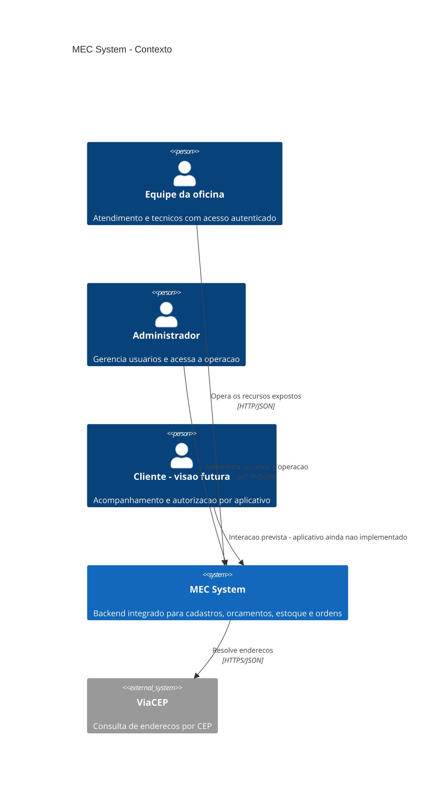
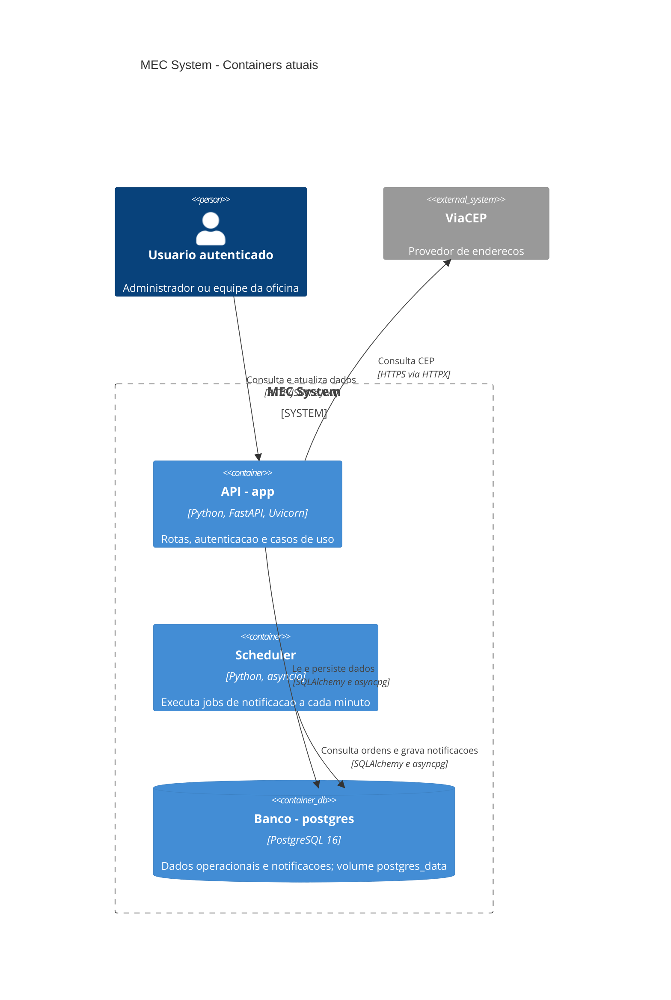
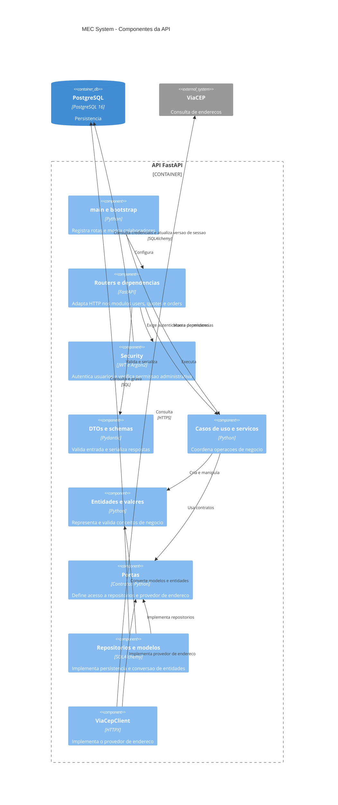

# 3 — Arquitetura do projeto

[Índice da wiki](README.md) · [Anterior: Stack](02-stack.md) · [Complemento: MER](04-modelo-de-dados.md)

## Organização arquitetural

O MEC System é um **monólito modular**, organizado por responsabilidades de negócio e por camadas. Os módulos `users`, `quotes` e `orders` compartilham uma aplicação FastAPI, uma base de código e um banco. O scheduler executa separadamente, usando a mesma imagem e os mesmos modelos.

## Estrutura do backend

```text
src/app/
├── main.py
├── config.py
├── bootstrap/
├── modules/
│   ├── users/
│   │   ├── domain/{entities,enums,value_objects}/
│   │   ├── application/{dtos,ports,services,use_cases}/
│   │   └── infrastructure/{clients,http,models,repositories}/
│   ├── quotes/
│   │   ├── domain/entities/
│   │   ├── application/{dtos,ports,use_cases}/
│   │   ├── infrastructure/{http,models,repositories}/
│   │   └── exceptions.py
│   └── orders/
│       ├── domain/{entities,enums}/
│       ├── application/{dtos,ports,use_cases}/
│       └── infrastructure/{http,jobs,models,repositories}/
└── shared/infrastructure/
    ├── database/
    ├── logging/
    └── security/
```

### Camadas e responsabilidades

| Pasta | Função no projeto |
| --- | --- |
| `domain/` | Reúne as estruturas e regras que representam os conceitos centrais da aplicação, separadas dos detalhes de transporte HTTP e persistência. |
| `domain/entities/` | Define objetos com identidade própria, seus atributos e as validações que mantêm esses objetos consistentes. |
| `domain/enums/` | Define conjuntos fixos de valores aceitos, evitando variações na representação dos dados. |
| `domain/value_objects/` | Agrupa atributos relacionados em objetos identificados por seus valores, sem identidade própria, e concentra suas validações. |
| `application/` | Organiza as operações oferecidas pelo sistema e coordena a colaboração entre regras, contratos e serviços. |
| `application/use_cases/` | Implementa cada operação da aplicação: recebe os dados de entrada, executa as etapas necessárias e aciona os colaboradores para produzir um resultado. |
| `application/dtos/` | Define a estrutura dos dados transferidos para os casos de uso, incluindo tipos, campos obrigatórios e validações de entrada. |
| `application/ports/` | Declara os contratos de acesso à persistência e aos serviços externos, permitindo substituir implementações sem alterar o contrato utilizado pelos casos de uso. |
| `application/services/` | Concentra rotinas de coordenação reutilizáveis, evitando repetir a mesma sequência de operações em diferentes casos de uso. |
| `infrastructure/` | Reúne as implementações técnicas que conectam a aplicação ao banco de dados, à interface HTTP e aos serviços externos. |
| `infrastructure/http/` | Define rotas, schemas e dependências HTTP. Recebe requisições, encaminha os dados aos casos de uso e prepara as respostas da API. |
| `infrastructure/models/` | Define o mapeamento entre objetos e tabelas do banco, incluindo colunas, tipos, restrições e relacionamentos. |
| `infrastructure/repositories/` | Implementa os contratos de persistência, executando consultas e gravações e convertendo os dados entre os modelos do banco e os objetos da aplicação. |
| `infrastructure/clients/` | Encapsula a comunicação com serviços externos, incluindo envio de requisições, leitura de respostas e tratamento de falhas de integração. |
| `infrastructure/jobs/` | Implementa rotinas de processamento em segundo plano ou em lote, executadas fora do fluxo de uma requisição HTTP. |

### Composição e serviços compartilhados

`main.py` cria a aplicação, registra routers, proteções de autenticação, handlers de erro e o ciclo de vida do cliente HTTP. `config.py` centraliza variáveis de banco, JWT e logging.

`bootstrap/` conecta implementações e casos de uso em arquivos como `users.py`, `budgets.py` e `orders.py`. Também contém comandos de criação de tabelas, migração de tipos de notificação, importação JSON, carga inicial, inicialização do servidor e execução dos jobs. É o ponto de montagem e operação da aplicação.

Em `shared/infrastructure/database/`, `base.py` define a base declarativa, `engine.py` configura engine e fábrica de sessões, `session.py` disponibiliza uma dependência de sessão e `integrity_errors.py` interpreta conflitos. As dependências HTTP dos módulos também abrem sessões com a fábrica compartilhada. Não existe uma sessão global única para todas as requisições.

`shared/infrastructure/logging/` centraliza o logger. `shared/infrastructure/security/` reúne rotas de autenticação, schemas, dependências de autorização, serviço, tokens, hashes e acesso às credenciais persistidas em `users`.

## C4 — Nível 1: contexto

O contexto apresenta os usuários do sistema e a integração externa. O cliente aparece como público da visão do produto, com sua interação futura explicitamente marcada.



## C4 — Nível 2: containers

No C4, container é uma unidade de execução ou armazenamento. Aqui, essas unidades também correspondem aos três serviços do Compose. Não há fila ou broker entre API e scheduler: ambos acessam o banco.



Na inicialização pelo Docker, o banco precisa estar saudável antes da API. `start_server.py` prepara tabelas e a migração de notificações, executa testes, carrega dados iniciais e inicia o Uvicorn. O scheduler aguarda o healthcheck da API, executa os dois jobs e repete os ciclos sem sobreposição. Essa dependência de inicialização não implica chamadas HTTP aos casos de uso da API durante os jobs.

## C4 — Nível 3: componentes da API

O diagrama agrupa componentes equivalentes dos três módulos para evidenciar as camadas. Cada módulo mantém seus próprios routers, casos de uso e repositórios.



As setas `implementa` representam conformidade a contratos, não chamadas em tempo de execução. O componente de segurança inclui seu próprio repositório de credenciais. O logger compartilhado e a chamada de hashing pelo caso de uso de cadastro foram omitidos do desenho para manter a leitura; esses acoplamentos existem no código.

## Conexões entre os módulos

`users` fornece as referências de pessoas e veículos. `quotes` vincula orçamentos a essas referências e consulta estoque para calcular o prazo. `orders` relaciona cada ordem a um orçamento, veículo, cliente e técnicos; seus jobs geram notificações vinculadas às pessoas e ao veículo.

Essas conexões são realizadas por referências de dados, composição de dependências e importações de modelos, sem barramento de eventos. Os relacionamentos persistidos e as diferenças entre vínculos reais e referências em JSON estão no [MER dos modelos SQLAlchemy](04-modelo-de-dados.md).

Os níveis C4 1 a 3 cobrem contexto, execução e componentes. O detalhamento de classes e tabelas é complementado pelo MER; o MER não é apresentado como um quarto nível C4.
