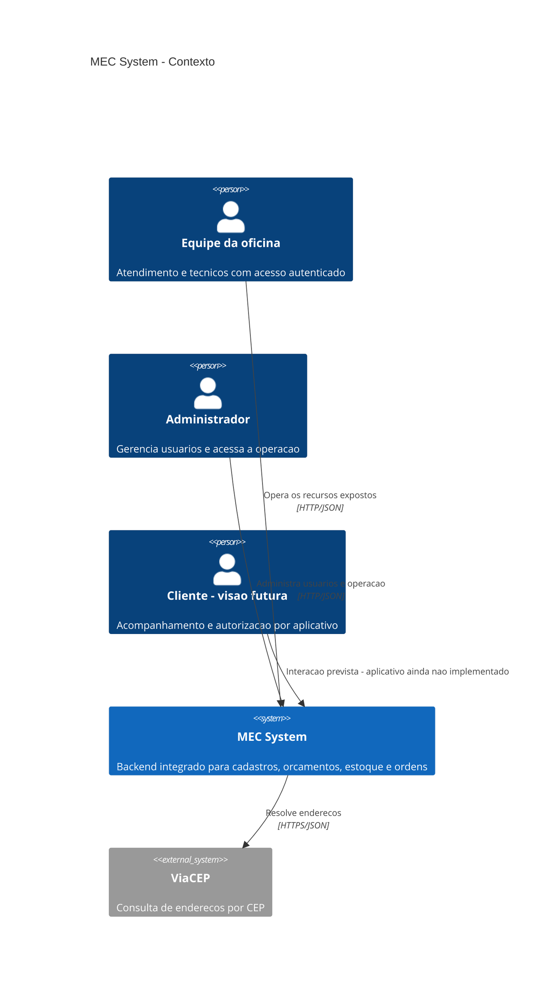
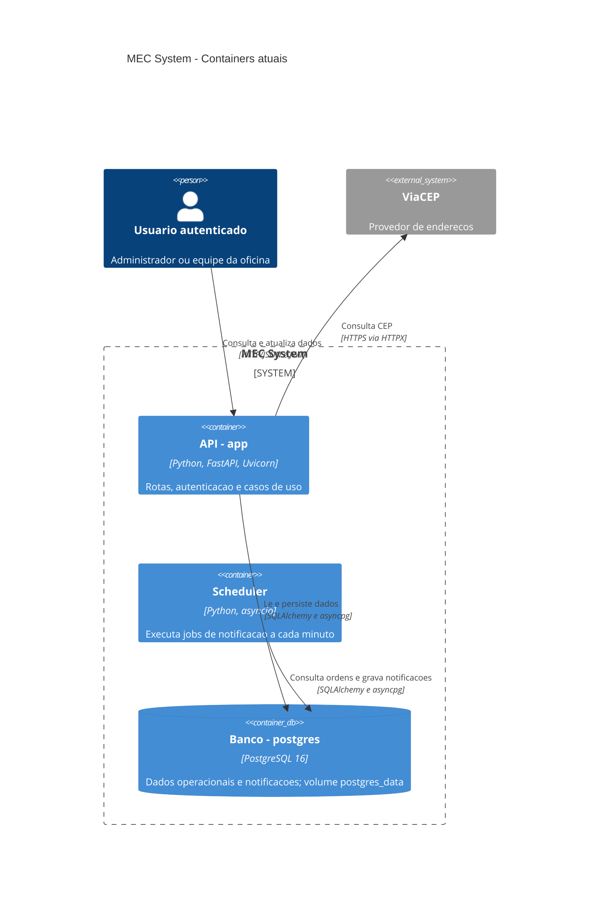
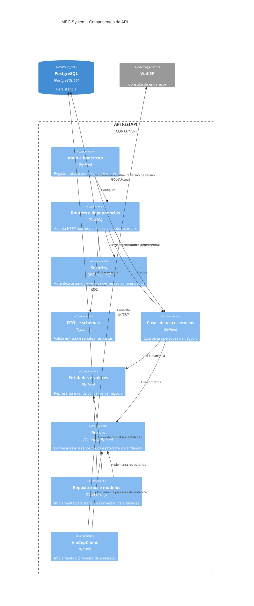

# 3 — Arquitetura do projeto

[Índice da wiki](README.md) · [Anterior: Stack](02-stack.md) · [Complemento: MER](04-modelo-de-dados.md)

## Organização arquitetural

O MEC System é um **monólito modular**, organizado por responsabilidades de negócio e por camadas. Os módulos `users`, `quotes` e `orders` compartilham uma aplicação FastAPI, uma base de código e um banco. O scheduler executa separadamente, usando a mesma imagem e os mesmos modelos. Essa separação de processo não transforma os módulos em microsserviços.

A organização se inspira em arquitetura limpa e em portas e adaptadores: entidades representam o negócio, casos de uso coordenam operações, portas definem contratos e adaptadores acessam HTTP ou banco. Essa é uma leitura da estrutura existente, sem pressupor isolamento absoluto: os DTOs dependem de Pydantic; casos de uso importam logging compartilhado e, no cadastro de usuários, funções de segurança e `run_in_threadpool` do Starlette. Os jobs consultam modelos SQLAlchemy diretamente.

## Pastas da raiz

| Pasta ou arquivo | Responsabilidade e objetivo |
| --- | --- |
| `src/app/` | Código executável do backend. |
| `dados/` | JSONs de usuários, veículos, estoque e orçamentos usados na ingestão. |
| `scripts/` | Automação operacional; contém o script PowerShell de sincronização de credenciais do PostgreSQL no container. |
| `tests/unit/` | Verificações focadas em regras, rotas, segurança, modelos, repositórios e inicialização; alguns testes usam banco isolado. |
| `tests/integration/` | Verificação de conexão com PostgreSQL. |
| `docs/` | Esta wiki e os diagramas arquiteturais. |
| `.venv/`, `.pytest_cache/` | Ambiente local e cache de testes; não são camadas da aplicação. |
| `.vscode/` | Configuração local do editor. |
| `.git/` | Metadados de versionamento. |
| `pyproject.toml`, `uv.lock`, `.python-version` | Configuração do pacote, dependências resolvidas e versão de Python para ferramentas locais. |
| `Dockerfile`, `docker-compose.yml`, `.dockerignore` | Imagem, serviços e exclusões do contexto de construção. |
| `.env.example`, `.env` | Exemplo de configuração e valores locais carregados pela aplicação. |
| `.gitignore`, `README.md` | Exclusões de versionamento e instruções operacionais. |

## Estrutura do backend

```text
src/app/
├── main.py
├── config.py
├── bootstrap/
├── modules/
│   ├── users/
│   │   ├── domain/{entities,enums,value_objects}/
│   │   ├── application/{dtos,ports,services,use_cases}/
│   │   └── infrastructure/{clients,http,models,repositories}/
│   ├── quotes/
│   │   ├── domain/entities/
│   │   ├── application/{dtos,ports,use_cases}/
│   │   ├── infrastructure/{http,models,repositories}/
│   │   └── exceptions.py
│   └── orders/
│       ├── domain/{entities,enums}/
│       ├── application/{dtos,ports,uses_cases}/
│       └── infrastructure/{http,jobs,models,repositories}/
└── shared/infrastructure/
    ├── database/
    ├── logging/
    └── security/
```

As chaves agrupam subpastas existentes, não diretórios literais. A grafia real é `use_cases` em `users` e `quotes`, mas `uses_cases` em `orders`. Ambas cumprem a mesma função arquitetural. Os arquivos `__init__.py`, onde presentes, identificam ou inicializam pacotes Python.

### Camadas e responsabilidades

| Caminho | O que faz | Exemplo e objetivo |
| --- | --- | --- |
| `domain/entities/` | Representa conceitos e validações de negócio, sem mapear tabelas. | `User`, `Vehicle`, `Budget`, `Stock`, `Order` e `Notification`. |
| `domain/enums/` | Define conjuntos de valores aceitos. | Papéis, combustível, tipo de veículo, status da ordem e tipo de notificação. |
| `users/domain/value_objects/` | Representa valores compostos sem identidade própria. | `Address` agrupa os dados de endereço. |
| `application/dtos/` | Define objetos de transferência de dados para entrada dos casos de uso. | `CreateUserDTO` valida dados de cadastro; DTO não é tabela nem entidade de domínio. |
| `application/use_cases/` e `application/uses_cases/` | Coordena uma operação de negócio e seus colaboradores. | Criar orçamento consulta estoque, calcula prazo e persiste a entidade. |
| `application/ports/` | Declara contratos para repositórios e provedores. | `UserRepository` e `AddressProvider` permitem substituir implementações. |
| `users/application/services/` | Reúne coordenação reutilizável entre casos de uso. | `AddressService` resolve endereços por meio do provedor. |
| `application/exceptions.py` | Define erros específicos da aplicação em usuários e ordens. | Permite distinguir falhas do fluxo; em `quotes`, o arquivo fica na raiz do módulo. |
| `infrastructure/http/` | Adapta chamadas HTTP: routers, schemas de resposta e dependências FastAPI. | Traduz entrada/saída e entrega o trabalho aos casos de uso. |
| `infrastructure/models/` | Define tabelas, colunas e relacionamentos SQLAlchemy. | Conversões `from_entity` e `to_entity` conectam domínio e persistência. |
| `infrastructure/repositories/` | Implementa as portas usando SQLAlchemy. | Executa consultas e gravações; vários métodos fazem commit e refresh. |
| `users/infrastructure/clients/` | Implementa integração com serviços externos. | `ViaCepClient` consulta CEP por HTTPX. |
| `orders/infrastructure/jobs/` | Executa processamento de notificações em lote. | Identifica ordens próximas do prazo ou atrasadas e grava notificações. |

### Composição e serviços compartilhados

`main.py` cria a aplicação, registra routers, proteções de autenticação, handlers de erro e o ciclo de vida do cliente HTTP. `config.py` centraliza variáveis de banco, JWT e logging.

`bootstrap/` conecta implementações e casos de uso em arquivos como `users.py`, `budgets.py` e `orders.py`. Também contém comandos de criação de tabelas, migração de tipos de notificação, importação JSON, carga inicial, inicialização do servidor e execução dos jobs. É o ponto de montagem e operação da aplicação.

Em `shared/infrastructure/database/`, `base.py` define a base declarativa, `engine.py` configura engine e fábrica de sessões, `session.py` disponibiliza uma dependência de sessão e `integrity_errors.py` interpreta conflitos. As dependências HTTP dos módulos também abrem sessões com a fábrica compartilhada. Não existe uma sessão global única para todas as requisições.

`shared/infrastructure/logging/` centraliza o logger. `shared/infrastructure/security/` reúne rotas de autenticação, schemas, dependências de autorização, serviço, tokens, hashes e acesso às credenciais persistidas em `users`.

## Como as camadas se conectam

Uma chamada de cadastro de usuário percorre o seguinte fluxo:

1. FastAPI recebe `POST /users`, aplica a exigência de administrador e valida a entrada com Pydantic.
2. As dependências HTTP obtêm o repositório e o cliente HTTP; `bootstrap/users.py` monta os casos de uso com `AddressService` e `ViaCepClient`.
3. `CreateUserUseCase` resolve o endereço, gera o hash da senha, constrói `User` e chama a porta de persistência.
4. `SQLAlchemyUserRepository` transforma a entidade em `UserModel` e salva por uma sessão SQLAlchemy no PostgreSQL.
5. O resultado retorna ao router e é serializado pelo schema de resposta.

A direção de execução vai da rota ao banco; a abstração de persistência é declarada na camada de aplicação e implementada na infraestrutura. Essa distinção permite substituir repositórios em testes por meio de `create_app(...)` ou das dependências FastAPI.

## C4 — Nível 1: contexto

O contexto apresenta os usuários do sistema e a integração externa. O cliente aparece como público da visão do produto, com sua interação futura explicitamente marcada.



## C4 — Nível 2: containers

No C4, container é uma unidade de execução ou armazenamento. Aqui, essas unidades também correspondem aos três serviços do Compose. Não há fila ou broker entre API e scheduler: ambos acessam o banco.



Na inicialização pelo Docker, o banco precisa estar saudável antes da API. `start_server.py` prepara tabelas e a migração de notificações, executa testes, carrega dados iniciais e inicia o Uvicorn. O scheduler aguarda o healthcheck da API, executa os dois jobs e repete os ciclos sem sobreposição. Essa dependência de inicialização não implica chamadas HTTP aos casos de uso da API durante os jobs.

## C4 — Nível 3: componentes da API

O diagrama agrupa componentes equivalentes dos três módulos para evidenciar as camadas. Cada módulo mantém seus próprios routers, casos de uso e repositórios.



As setas `implementa` representam conformidade a contratos, não chamadas em tempo de execução. O componente de segurança inclui seu próprio repositório de credenciais. O logger compartilhado e a chamada de hashing pelo caso de uso de cadastro foram omitidos do desenho para manter a leitura; esses acoplamentos existem no código.

## Conexões entre os módulos

`users` fornece as referências de pessoas e veículos. `quotes` vincula orçamentos a essas referências e consulta estoque para calcular o prazo. `orders` relaciona cada ordem a um orçamento, veículo, cliente e técnicos; seus jobs geram notificações vinculadas às pessoas e ao veículo.

Essas conexões são realizadas por referências de dados, composição de dependências e importações de modelos, sem barramento de eventos. Os relacionamentos persistidos e as diferenças entre vínculos reais e referências em JSON estão no [MER dos modelos SQLAlchemy](04-modelo-de-dados.md).

Os níveis C4 1 a 3 cobrem contexto, execução e componentes. O detalhamento de classes e tabelas é complementado pelo MER; o MER não é apresentado como um quarto nível C4.
