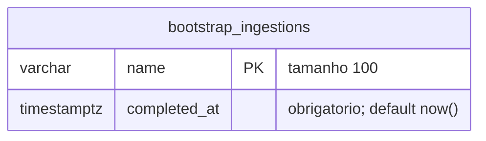

# 3.1 — Modelo de Entidade-Relacionamento

[Índice da wiki](README.md) · [Voltar à arquitetura](03-arquitetura.md)

Este MER descreve as seis tabelas mapeadas pelos modelos SQLAlchemy em `src/app/modules/*/infrastructure/models/`. Atributos, chaves e nulabilidade foram extraídos dos metadados dos modelos, sem conectar ao banco. Representam o esquema do código, não uma inspeção de um banco implantado.

## Legenda

- `PK`: chave primária; `FK`: chave estrangeira; `UK`: restrição de unicidade.
- `||`: exatamente um; `o|` ou `|o`: zero ou um; `o{`: zero ou muitos.
- Cada vínculo corresponde a uma FK real; seu rótulo identifica a coluna de origem.
- `obrigatorio` e `opcional` indicam `nullable=False` e `nullable=True`; o ORM ou banco pode preencher campos que tenham defaults.
- `timestamptz` representa `DateTime(timezone=True)`; `float` preserva a escolha dos modelos. Enums aparecem com seus nomes de mapeamento.

## MER físico dos modelos

```mermaid
erDiagram
    users {
        int id PK "obrigatorio"
        uuid system_id UK "obrigatorio"
        timestamptz create_at "obrigatorio"
        timestamptz update_at "obrigatorio"
        varchar primary_name "obrigatorio; tamanho 100"
        varchar secondary_name "obrigatorio; tamanho 100"
        varchar cpf UK "obrigatorio; tamanho 11"
        varchar email "obrigatorio; tamanho 254"
        varchar password_hash "opcional; tamanho 255"
        int token_version "obrigatorio"
        user_role role "obrigatorio; tamanho 9"
        varchar cep "obrigatorio; tamanho 8"
        varchar street "obrigatorio; tamanho 255"
        varchar neighborhood "obrigatorio; tamanho 255"
        varchar city "obrigatorio; tamanho 255"
        varchar state "obrigatorio; tamanho 2"
        varchar number "opcional; tamanho 50"
        varchar complement "opcional; tamanho 255"
    }
    vehicles {
        int vehicle_id PK "obrigatorio"
        int owner_id FK "obrigatorio"
        uuid system_id UK "obrigatorio"
        timestamptz create_at "obrigatorio"
        timestamptz update_at "obrigatorio"
        vehicle_type vehicle_type "obrigatorio; tamanho 10"
        varchar brand "obrigatorio; tamanho 100"
        varchar model "obrigatorio; tamanho 100"
        int year_manufacture "obrigatorio"
        int year_model "obrigatorio"
        varchar license_plate UK "obrigatorio; tamanho 7"
        varchar color "obrigatorio; tamanho 100"
        int mileage "obrigatorio"
        fuel_type fuel_type "obrigatorio; tamanho 8"
        varchar chassis "opcional; tamanho 17"
        int engine_capacity "opcional"
    }
    stock {
        uuid system_id UK "obrigatorio"
        varchar tool_id PK "obrigatorio; tamanho 100"
        varchar tool_name "obrigatorio; tamanho 100"
        varchar description "opcional; tamanho 255"
        double price "obrigatorio"
        varchar batch "obrigatorio; tamanho 100"
        int quantity "obrigatorio"
        double replacement_time_hours "obrigatorio"
        int replacement_time_days "obrigatorio"
        timestamptz create_at "obrigatorio"
        timestamptz update_at "obrigatorio"
    }
    budgets {
        uuid system_id UK "obrigatorio"
        int budget_id PK "obrigatorio"
        int vehicle_id FK "obrigatorio"
        int technical_id FK "obrigatorio"
        int client_id FK "obrigatorio"
        varchar technical_name "obrigatorio; tamanho 100"
        boolean technical_disponibility "obrigatorio"
        varchar service_name "obrigatorio; tamanho 100"
        varchar service_description "opcional; tamanho 255"
        jsonb tools "opcional"
        double amount "obrigatorio"
        double duration_service_hours "obrigatorio"
        int duration_service_days "obrigatorio"
        timestamptz create_at "obrigatorio"
        timestamptz update_at "obrigatorio"
    }
    orders {
        int order_id PK "obrigatorio"
        uuid system_id UK "obrigatorio"
        int client_id FK "obrigatorio"
        int technical_id FK "obrigatorio"
        int technical_responser_id FK "obrigatorio"
        int vehicle_id FK "obrigatorio"
        int budget_id FK "obrigatorio"
        varchar client_email "obrigatorio; tamanho 254"
        varchar technical_name "obrigatorio; tamanho 100"
        varchar technical_email "obrigatorio; tamanho 254"
        varchar technical_responser_name "obrigatorio; tamanho 100"
        varchar technical_responser_email "obrigatorio; tamanho 254"
        varchar service_name "obrigatorio; tamanho 100"
        varchar service_description "opcional; tamanho 255"
        double duration_service_hours "obrigatorio"
        int duration_service_days "opcional"
        order_status order_status "obrigatorio; tamanho 20"
        date service_date_start "opcional"
        date service_date_end "opcional"
        timestamptz create_at "obrigatorio"
        timestamptz update_at "obrigatorio"
    }
    notifications {
        notificationtype notification_type "obrigatorio; tamanho 30"
        uuid notification_id PK "obrigatorio"
        uuid system_id UK "obrigatorio"
        int order_id FK "opcional"
        int client_id FK "obrigatorio"
        varchar client_email "obrigatorio; tamanho 254"
        varchar client_name "obrigatorio; tamanho 100"
        int technical_id FK "obrigatorio"
        varchar technical_name "obrigatorio; tamanho 100"
        varchar technical_email "obrigatorio; tamanho 254"
        int technical_responser_id FK "obrigatorio"
        varchar technical_responser_name "obrigatorio; tamanho 100"
        varchar technical_responser_email "obrigatorio; tamanho 254"
        int vehicle_id FK "obrigatorio"
        varchar service_name "obrigatorio; tamanho 100"
        varchar service_description "opcional; tamanho 255"
        int duration_service_days "opcional"
        order_status order_status "obrigatorio; tamanho 20"
        date service_date_start "opcional"
        date service_date_end "opcional"
        timestamptz create_at "obrigatorio"
        timestamptz update_at "obrigatorio"
    }
    users ||--o{ vehicles : "owner_id"
    vehicles ||--o{ budgets : "vehicle_id"
    users ||--o{ budgets : "technical_id"
    users ||--o{ budgets : "client_id"
    users ||--o{ orders : "client_id"
    users ||--o{ orders : "technical_id"
    users ||--o{ orders : "technical_responser_id"
    vehicles ||--o{ orders : "vehicle_id"
    budgets ||--o{ orders : "budget_id"
    orders |o--o{ notifications : "order_id"
    users ||--o{ notifications : "client_id"
    users ||--o{ notifications : "technical_id"
    users ||--o{ notifications : "technical_responser_id"
    vehicles ||--o{ notifications : "vehicle_id"
```

## Interpretação dos relacionamentos

| Relação | Cardinalidade no esquema | Significado |
| --- | --- | --- |
| `users` → `vehicles` | Um usuário para zero ou muitos veículos. | Cada veículo exige um proprietário em `owner_id`. |
| `users` → `budgets` | Um usuário para zero ou muitos orçamentos em cada papel. | `client_id` e `technical_id` são FKs independentes. |
| `vehicles` → `budgets` | Um veículo para zero ou muitos orçamentos. | Cada orçamento exige `vehicle_id`. |
| `users` → `orders` | Um usuário para zero ou muitas ordens em cada papel. | Cliente, técnico e responsável técnico apontam para `users`. |
| `vehicles` → `orders` | Um veículo para zero ou muitas ordens. | Cada ordem exige um veículo. |
| `budgets` → `orders` | Um orçamento para zero ou muitas ordens. | `budget_id` é obrigatório, mas não é único; não há relação um para um imposta pelo modelo. |
| `orders` → `notifications` | Uma ordem para zero ou muitas notificações; uma notificação pode não apontar para ordem. | `order_id` aceita nulo. |
| `users` → `notifications` | Um usuário para zero ou muitas notificações em cada papel. | Cliente, técnico e responsável técnico são vínculos obrigatórios. |
| `vehicles` → `notifications` | Um veículo para zero ou muitas notificações. | `vehicle_id` é obrigatório mesmo quando `order_id` está ausente. |

As FKs garantem existência dos registros referenciados, mas não impõem por si só o papel do usuário nem que o cliente da ordem seja proprietário do veículo. Regras adicionais precisam ser verificadas na aplicação. O nome `technical_responser_id` foi mantido conforme o código.

## Estoque e itens de orçamento

`stock` aparece sem linha de relacionamento porque nenhum modelo declara FK para `stock.tool_id`. A coluna `budgets.tools` armazena uma lista JSONB de itens. A criação de orçamento consulta estoque pelos `tool_id`, agrega quantidades repetidas e considera o prazo de reposição quando falta quantidade.

Esse vínculo é validado na aplicação, não pelo PostgreSQL. Não existe tabela associativa `budget_items`; desenhá-la como parte do esquema atual seria incorreto. A criação de orçamento também não representa automaticamente reserva ou baixa de estoque.

## Identificadores e particularidades

`users.id`, `vehicles.vehicle_id`, `budgets.budget_id` e `orders.order_id` são inteiros com `Identity`. `stock.tool_id` é string de até 100 caracteres; `notifications.notification_id` é UUID. Todos os seis modelos possuem também `system_id` UUID único. CPF e placa são únicos; e-mail de usuário não possui essa restrição.

`Address` é um atributo composto de `UserModel`: seus campos são colunas de `users`, sem tabela de endereços separada. Hash de senha e versão dos tokens também ficam em `users`, sem tabela de credenciais própria.

Nomes, e-mails e descrições são repetidos em orçamentos, ordens e notificações. Esses valores persistidos não são sincronizados automaticamente pelos relacionamentos ORM quando o cadastro original muda.

Os valores `amount` e `price` são `float`, não `Numeric`/decimal. `create_at` e `update_at` registram criação e atualização, mas não constituem trilha completa de auditoria.

O status da ordem aceita `recebida`, `em_diagnostico`, `aguardando_aprovacao`, `em_execucao`, `finalizada` e `entregue`. O enum define valores aceitos; não comprova uma máquina de estados que obrigue essa sequência. `notification_type` aceita `upcoming` e `overdue`, usando enum não nativo, com padrão `upcoming`.

Os jobs evitam avisos repetidos para a mesma ordem, prazo e tipo pela lógica de processamento. `NotificationModel` não declara `UNIQUE` composto nesses três campos; o MER não atribui essa garantia ao banco.

## Tabela operacional fora do ORM

O bootstrap cria `bootstrap_ingestions` por SQL direto em [seed_initial_data.py](../src/app/bootstrap/seed_initial_data.py). Ela registra a conclusão da carga inicial e não é um dos seis modelos ORM.

Não há FK para os modelos de negócio. O marcador `initial_dados_v1` permite pular uma carga já concluída.

## Fontes no repositório

- [Usuários](../src/app/modules/users/infrastructure/models/users_model.py) e [veículos](../src/app/modules/users/infrastructure/models/vehicles_model.py).
- [Orçamentos](../src/app/modules/quotes/infrastructure/models/budgets_model.py) e [estoque](../src/app/modules/quotes/infrastructure/models/stock_model.py).
- [Ordens](../src/app/modules/orders/infrastructure/models/orders_model.py) e [notificações](../src/app/modules/orders/infrastructure/models/notification_model.py).
- [Criação de tabelas](../src/app/bootstrap/create_tables.py) e [regra de criação de orçamento](../src/app/modules/quotes/application/use_cases/create_budget.py).

A sintaxe segue a [documentação de diagramas ER do Mermaid](https://mermaid.js.org/syntax/entityRelationshipDiagram.html).
