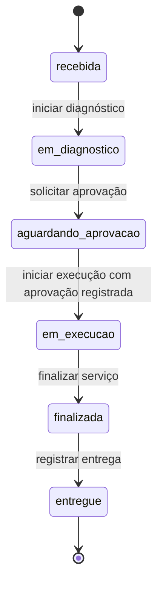

# Estudo: controle do ciclo de vida de ordens de serviço

Data: 31/10/2026. Escopo: análise do código e proposta de implementação; os endpoints abaixo ainda não existem. As regras propostas são uma base para o produto, não requisitos de negócio já confirmados.

## Diagnóstico do projeto

O monólito modular já separa domínio, casos de uso, portas e infraestrutura. A solução cabe no módulo `orders`, sem outro serviço ou biblioteca de workflow.

| Evidência no código | Comportamento atual | Consequência |
| --- | --- | --- |
| `src/app/modules/orders/domain/enums/order_status.py` | Seis status definidos | O vocabulário existe, mas não há regras entre os estados |
| `src/app/modules/orders/domain/entities/orders.py` | `Order` é uma dataclass sem métodos de transição | O domínio não impede saltos ou regressões |
| `src/app/modules/orders/application/dtos/order_dto.py` | Criação exige status; PATCH aceita status | É possível criar uma OS entregue ou avançar diretamente de recebida para entregue |
| `src/app/modules/orders/application/use_cases/update_order.py` | Aplica os campos com `setattr` | Não verifica origem, destino ou pré-condições |
| `tests/unit/test_update_order.py` | Testa recebida → em execução pelo PATCH com sucesso | A mudança exigirá atualizar o contrato e os testes existentes |
| `src/app/modules/orders/infrastructure/http/router_orders.py` | Apenas CRUD; todos os papéis internos podem modificar | Não há autorização específica por ação |
| `src/app/modules/orders/infrastructure/repositories/sqlalchemy_orders_repository.py` | Atualiza todos os campos e faz commit internamente | Não há controle explícito de versão nem transação conjunta com histórico |
| `src/app/modules/quotes/domain/entities/budget.py` | Orçamento sem aprovação ou versão | A existência de `budget_id` não comprova autorização do cliente |
| `src/app/modules/orders/application/use_cases/delete_order.py` | Exclui sem verificar status | Não preserva o ciclo de vida como regra de negócio |

As foreign keys verificam a existência dos registros, mas não asseguram que cliente, veículo e orçamento sejam coerentes entre si. Hoje `budget_id` é obrigatório desde a criação da OS: o sistema parte de um orçamento já existente, mesmo no estado `recebida`.

## Fluxo recomendado com os status existentes



Registrar aprovação é uma ação separada, sem mudar o status da OS. Assim, a aprovação do cliente não declara que o técnico já começou o trabalho. Enquanto não houver um estado adicional `aprovada`, a OS permanece em `aguardando_aprovacao`, com a aprovação explicitada na resposta.

Na primeira versão, proibir saltos, regressões e reabertura. `entregue` é terminal. Repetir uma transição sem mecanismo de idempotência retorna 409 e não gera novo histórico. Cancelamento e recusa definitiva exigem definição de produto e possivelmente novos valores no enum; não devem ser simulados com DELETE.

## Endpoints específicos propostos

Todos exigem JWT. Prefixo: `/orders/{order_id}`. O destino é definido pela rota, nunca por `order_status` enviado pelo consumidor.

| Método e sufixo | Origem → destino | Pré-condições e efeito |
| --- | --- | --- |
| `POST /start-diagnosis` | recebida → em_diagnostico | Responsável técnico válido e vínculos da OS coerentes |
| `POST /request-approval` | em_diagnostico → aguardando_aprovacao | Diagnóstico registrado; orçamento válido e revisão identificada |
| `POST /approve` | aguardando_aprovacao → mesmo estado | Registra consentimento referente à revisão exata do orçamento |
| `POST /start-execution` | aguardando_aprovacao → em_execucao | Aprovação vigente; responsável definido; registra início real |
| `POST /finish` | em_execucao → finalizada | Resumo do serviço realizado obrigatório; registra conclusão |
| `POST /deliver` | finalizada → entregue | Identificação do recebedor e registro da entrega |
| `GET /allowed-actions` | Sem alteração | Ações permitidas para o usuário e situação atuais, com versão da OS |
| `GET /history?offset=0&limit=100` | Sem alteração | Histórico paginado de ações |

Os POSTs retornam 200 com a OS atualizada, sua versão e dados pertinentes à ação. Histórico pode ter uma representação reduzida para clientes, sem observações internas. `allowed-actions` orienta a interface; o servidor revalida tudo no POST.

Exemplo de contrato para início de execução:

```http
POST /orders/7/start-execution
Authorization: Bearer <token>
Content-Type: application/json

{"expected_version": 4}
```

Exemplo de conflito:

```json
{
  "detail": {
    "code": "invalid_order_transition",
    "current_status": "recebida",
    "action": "start_execution",
    "allowed_actions": ["start_diagnosis"]
  }
}
```

Usar 401 para ausência de autenticação; 403 para ação sem permissão; 404 para OS inexistente ou fora do escopo de consulta; 409 para transição inválida, versão desatualizada ou pré-condição de negócio não atendida; 422 para corpo inválido. Não retornar status ou ações de OS alheia ao cliente.

## Permissões propostas

Esta matriz restringe o comportamento atual e precisa fazer parte da mudança de contrato.

| Perfil | Ações |
| --- | --- |
| `admin`, `manager` | Operar o fluxo e registrar aprovação externa com evidência; sem ignorar regras de transição |
| `technical` | Iniciar diagnóstico, solicitar aprovação, iniciar execução e finalizar apenas OS sob sua responsabilidade |
| `financial` | Consultar; sem transições operacionais na proposta inicial |
| `client` | Consultar e aprovar apenas sua própria OS |

Entrega fica com `admin` e `manager` inicialmente. Definir se responsabilidade técnica usa `technical_id`, `technical_responser_id` ou ambos; sugestão inicial: usar `technical_responser_id` para autorização operacional.

O código atual proíbe qualquer escrita de clientes em OS. `/approve` deve ter uma política específica: não pode simplesmente reutilizar `require_order_staff`. O autor da ação vem do JWT, nunca de um `actor_id` arbitrário do corpo. Aprovação registrada por funcionário deve distinguir o funcionário que registrou do cliente que consentiu e exigir referência da evidência.

## Regras que impedem contornar o fluxo

1. `POST /orders` fixa `recebida` no servidor. Remover `order_status` do DTO; com `extra="forbid"`, envios desse campo passam a retornar 422. Coordenar a mudança com consumidores.
2. Remover `order_status` do PATCH. Toda mudança de estado passa pelos comandos de domínio, inclusive chamadas internas.
3. Aplicar uma lista explícita de campos editáveis por fase. Proposta: permitir correções de vínculos e serviço em recebida/diagnóstico; congelar dados comerciais ao solicitar aprovação; bloquear PATCH genérico a partir de execução. Reatribuição de técnico, revisão e correções posteriores devem ter ações próprias e auditadas.
4. Bloquear exclusão física pela API operacional, retornando 409 para OS existente. Preservar histórico; retirada definitiva de registros é outra política, não uma transição.
5. Validar cliente do orçamento, veículo do orçamento e proprietário do veículo ao criar e ao alterar vínculos. Checar papel do técnico, não apenas existência do ID.
6. Proteger também a edição do orçamento em `quotes`: após solicitar aprovação, congelar a revisão referenciada ou gerar uma nova revisão que invalide o consentimento anterior. Uma modificação em `/budgets` não pode contornar o bloqueio em `/orders`.

## Onde implementar

| Camada/arquivo | Alteração proposta |
| --- | --- |
| `orders/domain/enums/order_action.py` (novo) | Enum das ações |
| `orders/domain/services/order_workflow.py` (novo) | Tabela de transições e validação de pré-condições, sem FastAPI/SQLAlchemy |
| `orders/domain/entities/orders.py` | Método que aplica transição válida e impede atribuição livre nos casos de uso |
| `orders/application/use_cases/transition_order.py` (novo) | Coordena leitura, autorização, validação, persistência e histórico |
| `orders/application/use_cases/approve_order.py` (novo) | Registra aprovação e revisão, sem iniciar execução |
| `orders/application/dtos/` | DTO específico por ação, com `expected_version` e campos obrigatórios |
| `orders/application/ports/order_repository.py` | Operação atômica de alteração condicionada à versão e gravação do evento |
| `orders/infrastructure/models/` | Versão da OS, aprovação e histórico |
| `orders/infrastructure/repositories/` | Implementa a transação e detecta conflito concorrente |
| `orders/infrastructure/http/router_orders.py` | Rotas finas que selecionam a ação fixa e passam o usuário autenticado |
| `app/bootstrap/orders.py` e dependências HTTP | Injeta os novos casos de uso e portas de orçamento/usuário/veículo necessárias |
| `app/main.py` | Handlers específicos para erros de workflow e concorrência |

As rotas podem compartilhar um caso de uso de transição, evitando cinco implementações divergentes. Não é necessário criar um endpoint genérico de troca de status. A consulta de ações disponíveis deve reutilizar a mesma política dos comandos.

## Persistência, auditoria e concorrência

Adicionar `version` inteiro não nulo em `orders`, com valor inicial 1. Registrar em tabela de eventos: identificador, OS, ação, estado anterior, estado seguinte, versão resultante, autor autenticado, data/hora com fuso e dados específicos da ação. Aprovação também produz evento, mesmo sem mudar o estado. Uma restrição única `(order_id, version)` evita eventos duplicados para a mesma versão.

Persistir estado, versão, aprovação e evento na mesma transação. Uma opção compatível com as portas atuais é um método dedicado `apply_action(...)` que realiza atualização condicional por `order_id` e `expected_version`, insere o evento e faz um único commit; falha em qualquer etapa faz rollback. Não chamar o atual `update()` e gravar histórico depois, porque o commit antecipado permitiria estado sem auditoria.

Se a atualização condicional não afetar a linha esperada, retornar conflito após preservar a política de escopo/inexistência. PATCH e outras operações que alterem pré-condições também precisam incrementar/verificar a versão. Controle de versão apenas nos novos endpoints não impede sobrescrita pelo CRUD antigo.

No fluxo de aprovação/início, proteger a revisão do orçamento na mesma unidade transacional, com revisão imutável ou bloqueio consistente compartilhado com a edição em `quotes`. Verificar uma revisão e permitir sua alteração concorrente antes do commit deixaria uma aprovação obsoleta válida.

Não prometer idempotência apenas com `expected_version`: uma repetição retorna 409. Se for necessário devolver o mesmo resultado após timeout, adicionar chave de idempotência persistida com escopo, hash da requisição e resultado, na mesma transação.

## Datas, prazos e notificações

Hoje a criação define início como `date.today()` e calcula término a partir de horas / 24. O atributo de dias é inteiro no domínio/modelo, mas recebe divisão fracionária na criação; durações menores que um dia também não são representadas precisamente por campos `date`.

Além disso, `quotes` calcula horas e dias separadamente, incluindo indisponibilidade do técnico e reposição de peças; `orders` recalcula dias a partir de horas informadas. Definir uma fonte de verdade para duração antes de vincular esses cálculos às transições. Somar novamente a espera por peças no início real pode contar espera já ocorrida duas vezes.

Para a primeira entrega, preservar `service_date_end` como prazo planejado usado pelos jobs e adicionar `execution_started_at`, `finished_at` e `delivered_at` para fatos reais. Não usar `service_date_end` como data de conclusão. Posteriormente, explicitar os nomes dos campos planejados e decidir prazo corrido versus jornada útil.

O job `notify_upcoming_orders.py` considera todos os estados exceto finalizada/entregue; `notify_overdue_orders.py` considera apenas em execução. Manter essas regras inicialmente, testar as fronteiras após transições e preservar notificações anteriores como registros históricos. Se surgirem cancelamento ou novos estados, revisar os filtros explicitamente.

## Implementação e validação sugeridas

1. Formalizar matriz, permissões, aprovação e política de edição/exclusão usando esta proposta como base.
2. Introduzir a política de domínio e seus testes; adicionar migração de versão, eventos, aprovação e datas reais.
3. Implementar persistência atômica e proteção da revisão do orçamento.
4. Adicionar endpoints, erros, escopo e consulta de ações; fechar os atalhos no POST/PATCH/DELETE e em `quotes` na mesma entrega.
5. Atualizar `http/orders.http`, OpenAPI, README e testes do contrato anterior.
6. Verificar dados legados sem inventar transições ou aprovações. Manter o status atual como marco inicial; para ordens aguardando aprovação, exigir novo registro de consentimento. Para ordens já em execução/finalizadas/entregues, registrar a origem legada sem fabricar autor ou data dos eventos passados.

Critérios de aceite:

- Cobrir todas as 36 combinações origem/destino, além da aprovação sem transição.
- Transição inválida, aprovação ausente/obsoleta ou versão divergente não altera OS nem gera evento.
- Testar autenticação, matriz de papéis, técnico responsável, aprovação própria e ocultação de OS alheia.
- Testar tentativa de contornar fluxo pela criação, PATCH, DELETE e edição do orçamento.
- Em PostgreSQL isolado, disparar duas ações com a mesma versão: somente uma confirma; falha no histórico reverte o estado.
- Concorrência entre edição do orçamento e início da execução não aceita revisão obsoleta.
- Confirmar datas reais, prazo planejado e inclusão/exclusão correta nos jobs após finalizar e entregar.
- Atualizar testes que hoje esperam mudança livre de status; rodar a suíte unitária e integração em banco isolado.

Não foram executados testes neste estudo: nenhuma regra de execução foi alterada. O resultado é uma especificação para implementação, baseada na inspeção do repositório.
